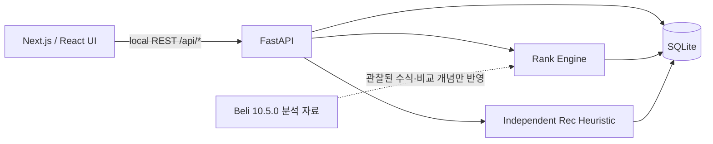
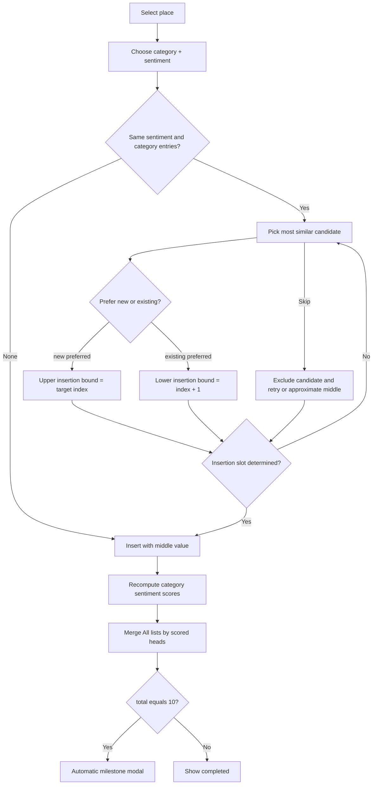

# Palate Lab — 실행 구조 및 역설계 근거

## Architecture

## Rank state machine

### API endpoint summary

| Method | Path | Purpose |
|---|---|---|
| GET | `/api/health` | Health |
| GET | `/api/places` | Search/filter places |
| GET | `/api/places/{id}` | Detail |
| GET | `/api/lists?category=All` | Personal score and k-way merge |
| GET | `/api/recommendations` | Own heuristic recommendations |
| GET | `/api/stats` | Counts and milestones |
| GET | `/api/bookmarks` | Want to Try list |
| POST | `/api/bookmarks/{id}` | Toggle bookmark |
| POST | `/api/ranks` | Begin evaluation / comparison draft |
| GET | `/api/drafts/{id}` | Read ongoing comparison |
| POST | `/api/drafts/{id}/decision` | Prefer new, prefer existing, undo, skip |
| POST | `/api/demo/reset` | Restore synthetic test fixture |

## Rule provenance

| Module | Status | Explanation |
|---|---|---|
| `engine.personal_score` | Client-derived | Client `calculateScoreLocal` equation |
| `engine.similarity` | Client-derived | City, price difference, cuisine and tag weights |
| `engine.choose_pivot` | Approximation | Highest similarity with median tied candidate; advanced directional features omitted |
| `main.decide` | Approximation | Comparison narrows insertion slot interval; skip approximates if candidate exhausted |
| `engine.k_way_merge` | Client-derived | Score first, category-order ties; category internal order preserved |
| `recommend.recommend` | Original | Own cuisine and budget based heuristic, NOT Beli model |
| `db.PLACES` | Sample fixture | Place meta and average scores are synthetic |
| `stats.milestones` | UX-derived demo | 10th completed evaluation triggers achievement locally |

## Future technical work

1. Add persisted **multiple users**, token authentication and per-user constraints.
2. Implement a confidence-aware adaptive pairwise ranker and compare against the client-derived baseline.
3. Add offline feature evaluation for ranking signal importance and recommendation quality.
4. Replace synthetic sample locations with authorized venue datasets and implement geospatial queries.
5. Add contract tests between the TypeScript client and Python response schemas.
